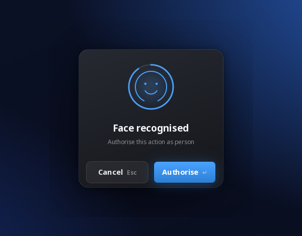

# howdy-confirm

[English](README.md) | **한국어**

[Howdy](https://github.com/boltgolt/howdy) 얼굴인식에 확인 단계를 더합니다. 얼굴이 인식되면 데스크톱에
이 작업을 승인할지 묻는 창이 떠서, 카메라 앞에 있다는 것만으로는 통과되지 않습니다.



Howdy는 IR 카메라가 얼굴을 보는 순간 통과시킵니다. 로그인 화면에서는 그게 장점이지만 다른 곳에서는
문제가 됩니다. 내가 실행한 스크립트가 `sudo`를 부르면, 마침 노트북을 보고 있었다는 이유만으로 그대로
통과합니다. 이 프로젝트는 Howdy의 *러버 스탬프*(얼굴이 맞은 뒤에 도는 추가 검사)로, 통과시키기 전에
먼저 묻습니다.

- **Enter**나 **Authorise**를 누르면 통과하고, **Esc**나 **Cancel**을 누르거나 창을 닫으면 거부합니다.
- 제한 시간 동안 원이 줄어듭니다. 시간이 다 되면 `failsafe` 규칙은 거부하고 `faildeadly` 규칙은
  통과시킵니다.
- 창을 띄울 데스크톱 세션이 없으면 터미널에서 묻습니다.

## 설치

```sh
git clone https://github.com/RedHatOnTop/howdy-confirm.git
cd howdy-confirm
sudo ./install.sh
```

그다음 `/etc/howdy/config.ini`에서 켭니다.

```ini
[rubberstamps]
enabled = true
stamp_rules =
	confirm	10s	failsafe	confirm_key=enter abort_key=esc
```

`install.sh`는 `confirm.py`를 Howdy 기본 스탬프 옆에 복사하고, Howdy의 스탬프 로더에
`rubberstamps-terminal.patch`를 적용합니다. 원본은 `__init__.py.orig`로 남습니다.
`sudo ./install.sh --remove`로 둘 다 되돌립니다. Howdy가 스크립트가 찾지 않는 곳에 있으면
`--howdy-dir`로 알려 주세요.

Howdy 패키지를 업데이트하면 로더가 바뀌어 패치가 사라집니다(패치가 들어가 있는 동안 `rpm -V howdy`는
이 파일을 변경됨으로 표시합니다). 업데이트 후에는 `install.sh`를 다시 실행하세요.

## 필요한 것

- Howdy 3.0. Fedora 44, Wayland GNOME 50에서 3.0.0으로 `sudo`에 써 봤습니다.
- 창을 그릴 PyGObject의 GTK 3과 pycairo(Fedora에서는 `python3-gobject`, `python3-cairo`).
- 터미널에서 물을 때 쓰는 Howdy의 `keyboard` 모듈.
- `install.sh`가 패치를 적용할 때 쓰는 `git`.

## 동작 방식

PAM 모듈 안에서 데스크톱에 창을 띄우기 까다로운 이유가 두 가지 있습니다.

`pam_howdy`는 Howdy의 비교 프로세스를 빈 환경 변수로 시작합니다(`posix_spawnp(..., envp = NULL)`).
그래서 `WAYLAND_DISPLAY`나 `DISPLAY`가 없습니다. 주어지는 건 사용자 이름뿐이라, 스탬프는 그 이름으로
`/run/user/<uid>`에서 세션을 찾습니다.

비교 프로세스는 PAM 스택을 실행한 프로그램의 setuid 상태도 물려받습니다. `sudo`에서는 `ruid != euid`가
되고, GTK는 이런 프로세스에서 시작하지 않습니다. 그래서 창은 도우미 프로세스가 그립니다. 같은 파일을
인증받는 사용자 권한으로 다시 실행하는데, fork와 exec 사이에서 권한을 내립니다. GTK가 원하는 조건이기도
하고, root로 창을 그리는 것보다 권한도 적습니다. 도우미는 종료 코드로 답합니다.

## 로더 패치

Howdy는 스탬프의 문구를 `howdy-gtk`로만 보여 줍니다. `howdy-gtk`가 없으면 스탬프의 안내가 어디에도
그려지지 않고, 시간이 다 되어 실패하며, 로그에는 "unknown error 15"만 남습니다. 패치는 `howdy-gtk`가
없을 때 문구를 stderr로 보내 PAM을 통해 터미널에 나오게 하고, 카운트다운은 바뀔 때만 출력합니다.
최신 파이썬이 경고하는 정규식 하나도 raw 문자열로 바꿉니다. Howdy 기본 스탬프인 `nod`와 `hotkey`도
같은 덕을 봅니다.

## 한계

- 실수로 승인되는 것을 막는 장치이지, 이미 내 권한으로 돌고 있는 프로그램을 막는 장치는 아닙니다. 그런
  프로그램은 승인 버튼을 직접 누를 수 있습니다(GNOME에서는 Mutter의 원격 데스크톱 API로 내 프로세스
  누구나 입력을 보낼 수 있습니다). 그러니 매번 의도해서 쓰는지 확인하는 장치로 보고, 내 계정을 상대로 한
  보안 경계로 여기지는 마세요.
- GDM 로그인 화면에서는 동작하지 않습니다. 로그인 전에는 세션이 없으니까요.
- 도우미는 런타임 디렉터리의 첫 번째 `wayland-*` 소켓을, 없으면 번호가 가장 낮은 X 디스플레이를
  씁니다. X11 경로, 터미널 안내, 그래픽 세션이 여러 개인 호스트는 아직 돌려 보지 않았습니다.

## 라이선스

Howdy와 같은 MIT입니다.
